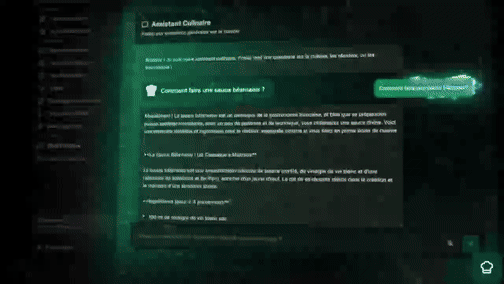

# claus.io

**Système expert de gestion de cuisine professionnelle** — génération de menus par IA, HACCP, inventaire, achats fournisseurs, planification du personnel et analyse aromatique des ingrédients (moteur Epicure).

Application de bureau **100 % locale** : vos données (fournisseurs, factures, stocks, températures) restent sur votre machine. **Aucune donnée n'est envoyée dans le cloud** — l'IA tourne sur votre propre ordinateur. **Plurilingue** : interface complète en français, anglais, allemand, espagnol et italien.

[](https://github.com/clausake/claus.io/actions/workflows/ci.yml)
[](./LICENSE)
[](https://nodejs.org)

<!-- Le « ?v= » n'est pas décoratif : l'URL brute d'une image est servie avec
     cache-control max-age=300 et les navigateurs (et les proxys) gardent la
     copie précédente du même chemin. Un lecteur qui avait ouvert le README
     avant la recapture voit « sans les onglets » pendant que le fichier servi
     est correct — mesuré le 15/10 (sha256 du fichier servi == fichier local,
     1680x1080). Changer cette chaîne force une URL neuve, donc un vrai
     téléchargement. La faire évoluer à chaque recapture. -->
<!-- La vidéo : GitHub SUPPRIME la balise <video> des README (mesuré par
     l'API /markdown : "<video>" -> "<p dir=auto></p>"). La seule voie fiable
     est un LIEN vers le .webm — sur github.com, ce lien s'ouvre dans le
     lecteur intégré de la page blob. La miniature est la capture du tableau
     de bord (image réelle du produit, pas une vignette fabriquée) : cliquer
     joue la vidéo. -->
<p align="center">
  <a href="public/demo-clausio.webm">
    
  </a>
</p>
<!-- Un GIF se rend EN LECTURE AUTO dans les README (pas d'interaction).
     Extrait de la vidéo 60s→93s : vitrine 3D Epicure, tableau de bord
     (KPIs, analyse des coûts, répartition du stock), analyse des menus,
     entrée en traçabilité HACCP. 8,4 Mo / 5 ips / 504 px. La vidéo complète
     reste au-dessus (miniature cliquable) et ici (lien direct). -->
<p align="center">
  
</p>
<p align="center"><strong>▶ Vidéo complète</strong> (miniature ci-dessus cliquable) — 6,4 Mo, WebM · <a href="public/demo-clausio.webm">ouvrir directement</a></p>

*Tableau de bord (image extraite de la démonstration) : valeur du stock en direct, alertes critiques, courbes de coûts sur 7 jours, répartition par catégorie.*


## Fonctionnalités

**Le logiciel est complet sans IA** : chaque module fonctionne en saisie manuelle (CRUD SQLite direct). L'IA est un assistant optionnel — elle pré-remplit, suggère, analyse ; le chef valide toujours. Un restaurant peut utiliser claus.io des années sans jamais configurer un moteur IA.

| Module | Ce qu'il fait | Sans IA |
|---|---|---|
| **Ingenierie des Menus** | Discutez avec l'assistant culinaire IA : il crée des fiches techniques complètes (ingrédients, quantités, étapes, allergènes) que le chef valide avant enregistrement | Création manuelle de fiches complète |
| **Hermes (suggestions)** | Surveille l'établissement (ruptures, DLC, températures) et propose des actions que l'humain applique de sa main | Désactivable (`COOKDRIVE_AGENT_OFF=1`) — boîte de suggestions fermée, tout le reste fonctionne |
| **Fiches Techniques & Food Cost** | Le livre de recettes par cartes (Entrée / Plat / Dessert), scan de menus papier par IA (OCR), export PDF — chaque fiche porte son coût matière par portion (food cost) | CRUD complet + export PDF (l'OCR n'est qu'un raccourci de saisie) |
| **Analyse de Menu** | Photo d'un menu → fiches techniques pré-remplies (le chef édite tout à 100 % avant de sauver) | Module IA pur — les fiches restent créables manuellement |
| **Inventaire** | Suivi des stocks, seuils d'alerte, import CSV, audit des écarts | 100 % sans IA (import CSV inclus) |
| **Achats** | Panier de production consolidé par fournisseur, bons de commande PDF, réceptions, comparaison de prix, mercuriales | 100 % sans IA |
| **HACCP** | Journal de conformité : températures IoT en temps réel (SSE), DLC, lots, nettoyage, preuves sanitaires, export PDF réglementaire | 100 % sans IA (saisie manuelle ou capteurs IoT) |
| **Plan de Production** | Recalcul automatique des quantités par nombre de couverts | 100 % sans IA (calcul arithmétique) |
| **Anti-gaspillage** | Suggestions de recettes par l'IA sur les stocks critiques | Module IA pur — l'inventaire reste complet |
| **Planification & Staff Management** | Planning hebdomadaire du personnel, taux horaire par poste, calcul automatique des heures travaillées et du coût de main-d'œuvre (labor cost), consolidé au dashboard | 100 % sans IA |
| **Dashboard** | Courbes quotidiennes **food cost** (achats fournisseurs) et **labor cost** (planning × taux horaires), valeur du stock, alertes en temps réel | 100 % sans IA |
| **Epicure Studio** | Analyse aromatique : embeddings d'ingrédients, substitutions, accords | Analyse locale (embeddings, pas un LLM) |

## Intelligence : 100 % local par défaut, multi-moteurs

Le choix se fait dans **Réglages → Intelligence** et est **effectif à la génération** (jugé par la CI — voir `src/shared/llm.ts` et sa morsure) :

- **Moteur d'inférence local** (par défaut) — vision incluse, repli OCR Tesseract automatique
- **Serveurs locaux compatibles OpenAI** — llama.cpp-server, **vLLM** (port 8000 détecté automatiquement), SGLang, LM Studio (`/v1/chat/completions`)
- **Fournisseurs cloud** (optionnel, liste blanche fermée) : OpenAI, Mistral, Anthropic, Cohere, DeepSeek — la clef d'API vit dans l'environnement (`OPENAI_API_KEY`...), jamais en base, jamais à l'écran ; l'URL de la liste ne peut pas être remplacée (anti evil-proxy)

**Hermes**, le cerveau de suggestions, surveille l'établissement (ruptures, DLC, températures) et propose des actions — que l'humain applique de sa main (le compte IA n'a jamais le droit d'écrire : 403 sur toute route mutable).

La liste des serveurs locaux est détectée automatiquement au démarrage (ports 11434, 8080, 1234, 8000).

## Architecture

- **Frontend** : React 19 + Vite + Tailwind CSS, lazy-loading par vue
- **Backend** : Express + SQLite (20 routeurs, `server.ts` 258 lignes), `127.0.0.1:3000`
- **Desktop** : Electron (Windows NSIS, macOS DMG, Linux AppImage/deb)
- **OCR** : PaddleOCR PP-OCRv5 (12,8 Mo, hors ligne) + repli Tesseract
- **Epicure** : embeddings d'ingrédients 300d (arXiv:2605.22391)
- **Identité** : sessions argon2, audit trail de chaque écriture (règlement CE 852/2004 art. 5)

## Prérequis

- **Node.js >= 22**
- **Python 3.12** (pour le lot des portes de qualité)
- **Un moteur IA local** de votre choix — ou aucun : le logiciel fonctionne sans IA

## Installation

**En installateur (pré-empaqueté, sans Node)** : les images compilées (AppImage ARM64 et .deb ARM64 pour Linux, installeur NSIS Windows x64, et .dmg Apple Silicon pour macOS) sont attachées à la [release](https://github.com/clausake/claus.io/releases). Les images Windows et macOS sont non signées : une confirmation manuelle (SmartScreen / clic droit → Ouvrir) est demandée à la première ouverture.

> ⚠️ **v0.1.0** : ces installeurs ouvraient une page « Not Found » (le serveur
> cherchait son dossier `dist` dans le dossier courant de l'exécutable au lieu de
> son archive) et tournaient avec le moteur d'accords Epicure en vecteurs nuls.
> Corrigé au chantier 20 — prendre l'installeur **0.1.1** ou plus récent. Le ZIP
> + `LANCER_APPLICATION.bat` de v0.1.0 échouait à la compilation pour la même
> famille de raison : le script forçait `NODE_ENV=production` avant `npm install`,
> ce qui fait sauter à npm les devDependencies (`vite`, `tsx`). Corrigé aussi.

**De source** (développeur) :

```bash
git clone https://github.com/clausake/claus.io.git
cd claus.io
npm install            # (les devDependencies sont nécessaires : vite, tsx)
npm run build          # compile dist/ — le .bat le fait pour vous
cp .env.example .env   # renseigner si nécessaire
```

## Lancement

```bash
npm run dev     # développement : http://localhost:3000
npm start       # production locale
```

Windows : `LANCER_APPLICATION.bat`. L'URL du moteur IA est configurable dans les Réglages.

## Build des exécutables

```bash
npm run build:exe     # Windows (NSIS)
npm run build:mac     # macOS (DMG)
npm run build:linux   # Linux (AppImage, deb)
```

## Qualité

Le projet est jugé par **86 portes automatiques** exécutées à chaque push (CI GitHub Actions) : types (zéro `:any`), 170 tests unitaires, 46 routes en contrats e2e, sécurité (sessions, rate-limit, audit trail, CSP), contrats métier, la navigation **UI intégrale** (les 13 onglets jugés dans un vrai navigateur : rendu + console propre), et vérification cryptographique du journal des phases. Chaque porte a une morsure qui prouve qu'elle peut rougir.

```bash
npm run verify:all            # le lot complet
python3 scripts/lire-gates.py # qui est rouge
```

## Données

100 % locales : SQLite, uploads et réglages dans `%APPDATA%\ClausIO` (Windows) ou `~/.clausio` (macOS/Linux).

## Licence

### Code claus.io — EUPL-1.2

Logiciel libre sous **[EUPL-1.2](./LICENSE)**.

- **Usage** : gratuit pour tous, y compris professionnel (restaurants, traiteurs...)
- **Aucune activation, aucune clé** : pas de période d'essai, pas de limite de temps — rien ne se bloque après un nombre de jours
- **Modification** : libre ; toute version modifiée doit rester sous EUPL-1.2 et publier son code source (SaaS inclus)
- **Revente du logiciel** : **interdite** — quiconque distribue claus.io (modifié ou non) doit partager l'intégralité de son code sous la même licence. Le logiciel ne peut pas devenir un produit payant fermé
- **Services autour du logiciel** (installation, support, formation, hébergement) : possibles
- **Copyright** : © 2026 ClausIO

### Composants tiers

Les données **Epicure** (embeddings d'ingrédients) sont redistribuées sous **CC BY 4.0** avec attribution (Radzikowski & Chen, arXiv:2605.22391). OCR `fra.traineddata` : Apache 2.0. Détails : [`NOTICE.md`](./NOTICE.md).
